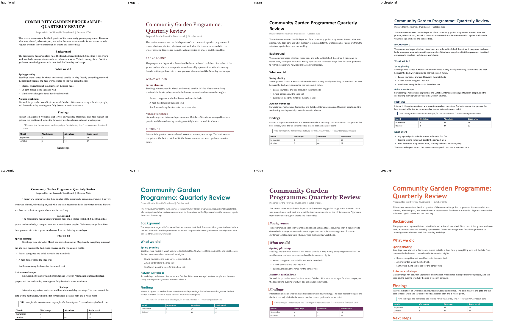
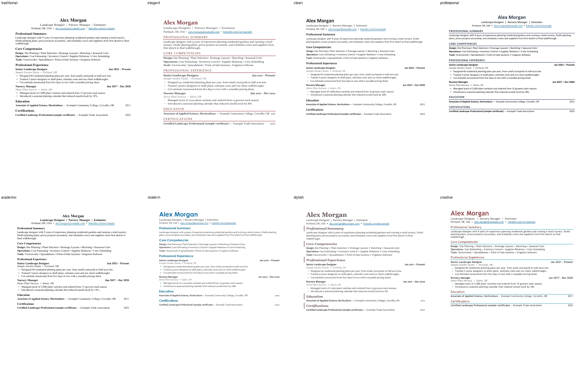
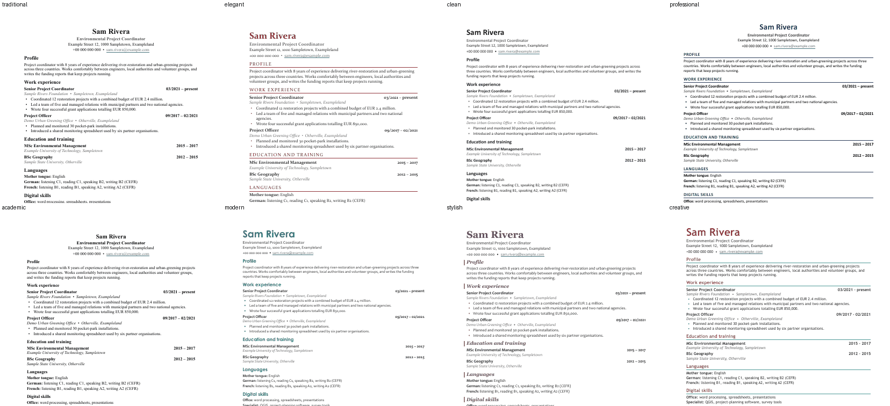

# Document styles

Eight ready-made looks, each as a **document** (title, headings, body, bullets, quote), as an **ATS-friendly résumé**
and as a **European-style CV** (single column, real headings, no tables or text boxes), on **US Letter or A4**. One spec file feeds both apps, so WordCraft and ONLYOFFICE
produce the same look. All sample text is invented.

| Style | Look | Good for |
|---|---|---|
| `traditional` | Times, black, centred headings, justified text | Formal letters, legal-style documents, conservative readers |
| `elegant` | Constantia/Georgia, burgundy, letter-spaced small headings with a hairline rule, wide margins | Invitations, personal statements, boutique-client proposals |
| `clean` | Calibri, dark grey, lots of white space, no ornament | Everyday documents, memos, handouts |
| `professional` | Calibri, navy all-caps headings with a bottom rule | Business reports, proposals, ATS résumés |
| `academic` | Times 12 pt, double-spaced, first-line indents, plain bold headings | Essays and papers (check your style guide's specifics) |
| `modern` | Century Gothic headings in teal, Corbel body, large title | Product docs, newsletters, design-aware résumés |
| `stylish` | Georgia italic plum headings with a gold bar, Candara body | Programmes, editorial handouts, brand-conscious proposals |
| `creative` | Coral headings, teal rule, Trebuchet, big title | Portfolios, workshop handouts, creative-field résumés |





(More in `gallery/`: both apps, documents and résumés.)

## Use

```sh
python3 -I resolve.py                                   # which font each style gets on this machine
# WordCraft: writes out.docx
python3 -I build_wordcraft.py modern doc /abs/out.docx > job.json && wordcraft-cli run --script job.json
python3 -I build_wordcraft.py modern resume /abs/resume.docx > job.json && wordcraft-cli run --script job.json
python3 -I build_wordcraft.py modern cv /abs/cv.docx > job.json && wordcraft-cli run --script job.json          # European CV, A4
python3 -I build_wordcraft.py clean doc /abs/report_a4.docx --paper=a4 > job.json && wordcraft-cli run --script job.json
# ONLYOFFICE (headless; add --pdf to also save a PDF rendered by ONLYOFFICE for checking; same --paper option)
python3 -I build_onlyoffice.py modern doc /abs/out.docx > calls.json && python3 -I ../onlyoffice/tools/ooc.py new:docx calls.json
```

Replace the invented text in `content.py` with real content (keep the block types). To restyle a real document instead of
the sample, copy the `styles.modify` / style-creation part of a builder and apply it to the existing styles, then give
paragraphs the style names (`Heading 1`, `Heading 2`, `Doc Title`, …). Always work on a copy of someone's document.

## Fonts and fallbacks

Each style lists fonts in order of preference in `styles.json`; `resolve.py` picks the first one that is **installed** here.
By default it also requires a font that ships with Microsoft Office (Calibri, Cambria, Candara, Century Gothic, Constantia, Corbel,
Georgia, Arial, Times New Roman, Trebuchet MS, Verdana…), so a file opens the same on a colleague's computer. `--local-fonts`
lets any installed font win (e.g. Montserrat or Open Sans): only use it for documents that stay on this machine or embed the
fonts. If a preferred font is missing the resolver reports it and uses the next one; the look then differs slightly.

## Paper size

`--paper=letter` (default for `doc` and `resume`) or `--paper=a4` (default for `cv`) on both builders. The builders set the page size, margins
and the right-hand tab used for dates, so nothing else changes between sizes; A4 is a little narrower and taller (595 × 842 pt) than Letter (612 × 792 pt).
Checked: both sizes report the right page size in both apps, and the CVs stay on one page in all eight styles.

## CV (European style)

`cv` is a single-column curriculum vitae laid out the way European employers expect: name, role and contact lines; *Profile*; *Work experience* (newest
first, dates as `MM/YYYY – present`); *Education and training* (degree and years, institution underneath); *Languages* (mother tongue, then each language
with CEFR levels A1–C2 for listening, reading, speaking and writing); *Digital skills*; *Certificates*; *Interests*. It is inspired by the Europass
structure but is **not** the official Europass template. Notes: a photo, date of birth, nationality and marital status are expected in some countries and
discouraged or unlawful to ask for in others (including the US and UK), so none are included; add them only where the local norm calls for it.
Two pages are normal for a senior CV. Keep the single column so portals can read it.

## Résumé formats

The builders produce the **reverse-chronological** layout (summary, competencies, experience, education, certifications):
the best default for ATS software and most recruiters. Two other content structures work with every style by reordering the
same sections: **functional** (skills grouped by theme first, short job list after; use when career gaps or a change of field
would make a timeline work against you, but some recruiters distrust it) and **combined** (summary and a skills block first,
then a timeline: good for experienced people changing direction). Keep one column and real headings in all of them; use
`creative` or `stylish` for a designed copy to send to a person, and `professional`/`clean`/`traditional` for portals.

## Checked

Every style (document, résumé and CV) was built in both apps and rendered (WordCraft with its own renderer, ONLYOFFICE through its own PDF export).
Letter-spacing, caps, borders, tab stops, bullets and links reach the saved `.docx` (inspected in `styles.xml`).
Not covered: tables, headers/footers, page numbers, columns, photos in CVs.
