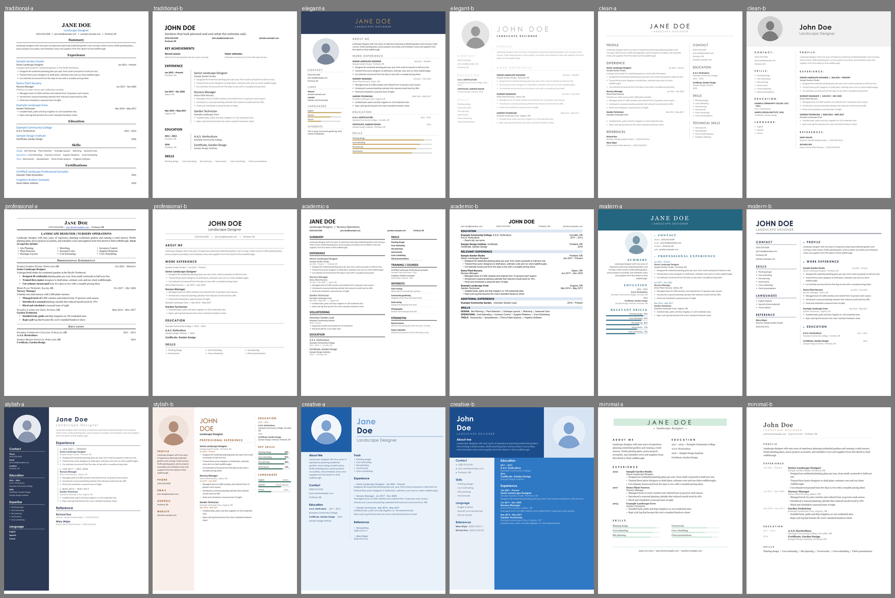
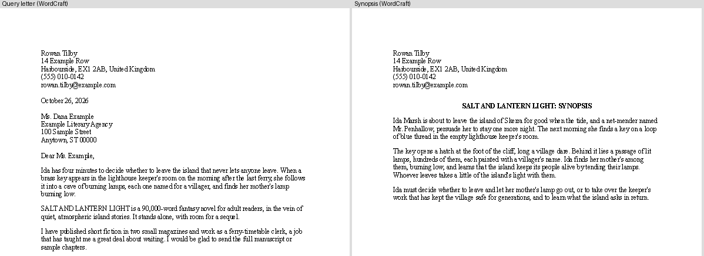
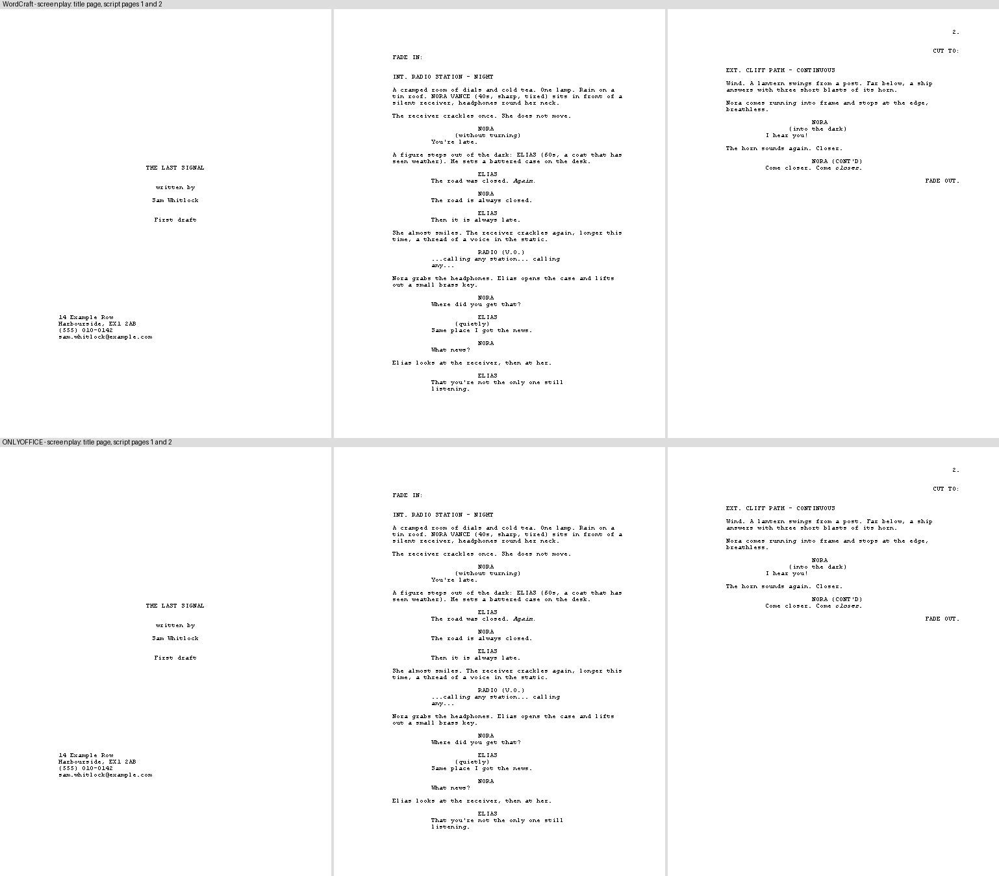
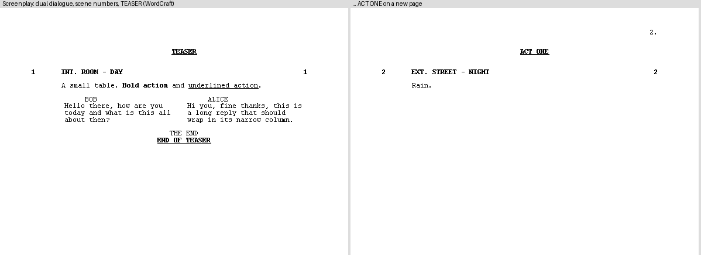
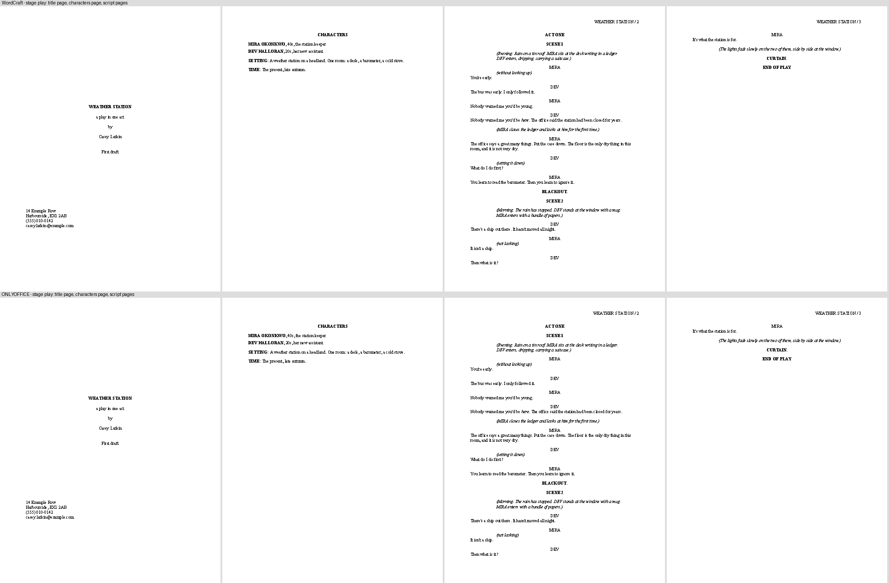
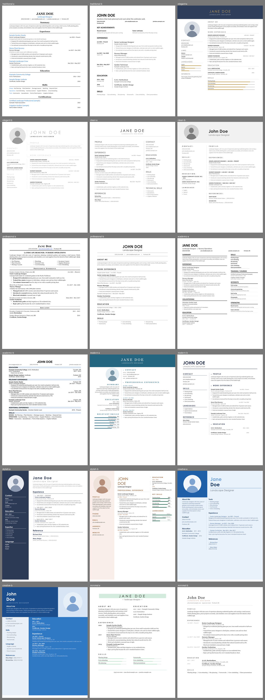
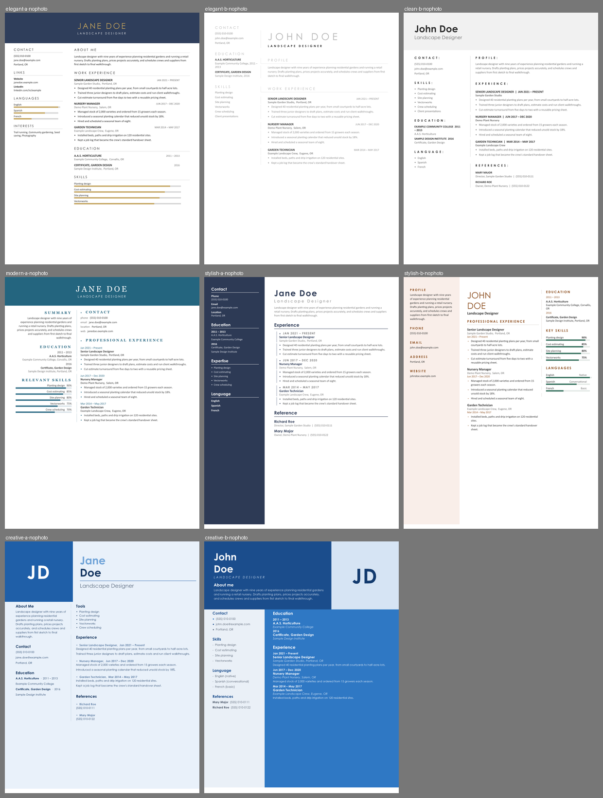

# Document styles

Eight ready-made looks. Each comes as a **document** (title, headings, body, bullets, quote, table, optional figure, footnote and right-to-left or CJK text), an **ATS-friendly résumé**, a
**European-style CV**, and (for the academic style) an **APA or MLA student paper**, on **US Letter or A4**. One plan feeds both
WordCraft and ONLYOFFICE, so they produce the same look. All sample text is invented.

| Style | Look | Good for |
|---|---|---|
| `traditional` | Times, black, centred headings, justified text | Formal letters, legal-style documents, conservative readers |
| `elegant` | Constantia/Georgia, burgundy, letter-spaced small headings with a hairline rule, wide margins | Invitations, personal statements, boutique-client proposals |
| `clean` | Calibri, dark grey, lots of white space, no ornament | Everyday documents, memos, handouts |
| `professional` | Calibri, navy all-caps headings with a bottom rule | Business reports, proposals, ATS résumés |
| `academic` | Times 12 pt, double-spaced, first-line indents, plain bold headings | Essays and papers (with `paper`: APA or MLA layout) |
| `modern` | Century Gothic headings in teal, Corbel body, large title | Product docs, newsletters, design-aware résumés |
| `stylish` | Georgia italic plum headings with a gold bar, Candara body | Programmes, editorial handouts, brand-conscious proposals |
| `creative` | Coral headings, teal rule, Trebuchet, big title | Portfolios, workshop handouts, creative-field résumés |





The résumé previews show the redesigned layouts (nine styles, two layouts each; see "Redesigned résumés" below). The plain single-column ATS résumé is still the `resume` kind of `build_wordcraft.py`. More in `gallery/` (both apps; documents, A4 CVs, features; the CV and feature images were made before the sample name changed to Jane Doe).

## Use

```sh
python3 -I resolve.py                                   # which font each style gets on this machine
# WordCraft: writes the .docx
python3 -I build_wordcraft.py modern doc /abs/report.docx > job.json && wordcraft-cli run --script job.json
# ONLYOFFICE (headless): add --pdf to also save a PDF rendered by ONLYOFFICE, for checking
python3 -I build_onlyoffice.py modern doc /abs/report.docx > calls.json && python3 -I ../onlyoffice/tools/ooc.py new:docx calls.json
```

`KIND` is `doc`, `resume`, `cv`, `paper`, `manuscript`, `screenplay`, `stageplay`, `query` or `synopsis` (see below; the STYLE argument is ignored for the last five). Options, the same in both builders (`--name=value`):

| Option | Applies to | What it does |
|---|---|---|
| `--paper=letter` / `--paper=a4` | all | Page size. Default Letter; `cv` defaults to A4. |
| `--page-numbers=bottom-center` / `bottom-right` / `top-right` | all | Page number in the footer or header. |
| `--header-text="Short title"` | all | Text in the header (with `top-right`, text then number). |
| `--columns=2` | `doc` | Body in two columns after the title (newsletter feel). |
| `--photo=/abs/pic.png` | `resume`, `cv` | Portrait above the name. |
| `--layout=chronological` / `functional` / `combined` | `resume` | Which résumé structure. |
| `--format=apa` / `--format=mla` | `paper` | Student-paper layout. |
| `--extras` | `paper` | Abstract (APA), block quote, captioned table. |
| `--figure=sample` / `--figure=/abs/pic.png` | `doc` | Picture with a caption after the table. |
| `--merged-table` | `doc` | Adds a merged title row above the table header. |
| `--footnotes` | `doc`, `paper` | One sample footnote. |
| `--script=arabic` / `hebrew` / `japanese` / `chinese` / `korean` | `doc` | One sample sentence in that script (right-to-left handled). |
| `--local-fonts` | all | Allow fonts installed here but not shipped with Office. |
| `--overwrite` | all | Replace an existing output file (otherwise the builder refuses). |

Cautions (for example "photo is not ATS-safe") are printed to stderr. Replace the invented text in `content.py` with real content; keep the
block types. To restyle a real document instead of the sample, copy the style-setting part of a builder onto the document's existing styles
and give paragraphs the style names (`Heading 1`, `Heading 2`, `Doc Title`, …). Always work on a copy of someone's document.

## Manuscript for a publisher or agent (`manuscript`)


Standard manuscript format as most fiction submissions expect it: 12 pt Times New Roman (or Courier New), double-spaced, 1-inch margins, ragged right,
0.5-inch first-line indents, no extra space between paragraphs, italics (not underlining) for emphasis, a title page, a running header
`Surname / TITLE / page` that does not print on page 1, chapters on new pages starting about a third of the way down, `#` for scene breaks, `THE END`.
**Always follow the publisher's or agent's own guidelines first**: this is the common default, not a rule everyone shares.

```sh
python3 -I build_wordcraft.py x manuscript /abs/book.docx --title="My Title" --author="Jane Doe" --address="1 Main St|Anytown, ST 00000" \
    --phone="555-0100" --email=jane@example.com --text=/abs/my-text.txt > job.json && wordcraft-cli run --script job.json
python3 -I manuscript_check.py /abs/book.docx            # PASS / WARN / FAIL against the rules above
```

| Option | What it does |
|---|---|
| `--text=/abs/file.txt` | Your text. A line `# Chapter One` starts a chapter; a line `#` or `* * *` alone is a scene break; blank lines separate paragraphs; `*word*` is italic; a paragraph starting `> ` is a block quotation; lines each starting `\| ` are verse (line breaks kept, single-spaced, indented); `[^note text]` inside a paragraph becomes a real footnote (put it right after the words it belongs to; most fiction submissions should not use footnotes); `THE END` closes the book. Without it, an invented sample is built. |
| `--title=` `--author=` `--pen=` `--surname=` | Title page and header. `--pen` is the byline if it differs from the legal name; the surname defaults to the last word of the author. |
| `--address="Line 1\|Line 2"` `--phone=` `--email=` | Contact block, top left of the title page. |
| `--wordcount=N` | The "about N words" line. Default: counted from your text and rounded (nearest 50 under 1,000, 100 under 10,000, otherwise 1,000). |
| `--font=courier` | Courier New instead of Times New Roman (same layout). |
| `--layout=short` | Short story: the text starts on the title page below the byline (default `novel`: separate title page, every chapter on a new page). |
| `--paper=a4` | A4 instead of US Letter. |

What to know (all verified on WordCraft 0.11.0 and ONLYOFFICE 10.0.0; both apps render the same pages):
- The word count is **not a field**: it is the number the builder counted. Re-run the builder (or change `--wordcount`) after editing the text.
- Chapter openings use six empty double-spaced paragraphs to drop a third of the way down, because WordCraft's layout ignores "space before" at the top of a page. They are
  intentional (`manuscript_check.py` allows runs of up to seven).
- Chapter headings are real `Heading 1` paragraphs, so a Word-style navigation pane or an accessibility checker sees the structure.
- `manuscript_check.py` also prints the page count and words per page when `wordcraft-cli` is installed. In ONLYOFFICE a footnote mark lands at the END of its paragraph (that tool anchors there).
- Not covered: tables, pictures and a table of contents (fiction submissions do not use them; a non-fiction proposal needs its own layout); a bibliography.

### Query letter and synopsis (`query`, `synopsis`)



The two documents that usually travel with a manuscript. `query`: a one-page business letter (contact block, date, the agent's address, salutation, paragraphs, "Sincerely,"), single-spaced Times 12 pt.
`synopsis`: single-spaced, centred bold heading "TITLE: SYNOPSIS", header `Surname / TITLE / Synopsis / page` from page 2. Same options as the manuscript (`--title --author --address --phone --email --text`), plus for the query
`--agent="Ms. Name|Agency|Street|City"` and `--date="October 26, 2026"`. The text file is plain paragraphs separated by blank lines (`*italic*` allowed); the letter's salutation is part of your text. Each agent publishes
their own length and format asks (a query is usually 250-400 words, a synopsis one to two pages): follow theirs.

## Screenplay (`screenplay`)



The common spec-script layout for film: Courier New 12 pt on a fixed 12 pt line pitch (6 lines per inch, so a page is about a minute), left margin 1.5 in,
other margins 1 in. Element indents measured from the page edge: scene heading and action at 1.5 in, character cue at 3.7 in, dialogue 2.5 in to 6.0 in,
parenthetical 3.1 in to 5.5 in, transition right-aligned. The title page is its own section; the script then starts at page 1 with no number, and
pages 2, 3 … print `2.` `3.` at the top right. **A producer's, contest's or studio's own rules come first**: this is the usual default.

```sh
python3 -I build_wordcraft.py x screenplay /abs/script.docx --title="My Film" --author="Jane Doe" --email=jane@example.com --draft="First draft" \
    --text=/abs/script.txt > job.json && wordcraft-cli run --script job.json
python3 -I screenplay_check.py /abs/script.docx          # PASS / WARN / FAIL: margins, indents, Courier, line pitch, capitals, page numbers
```

Text input (`--text=`) is a Fountain-like subset, so a script written in any plain-text editor can be formatted:

| Write | You get |
|---|---|
| `INT. KITCHEN - MORNING` (or `EXT.`, `EST.`, `INT./EXT.`, `I/E`; or a leading `.` to force) | scene heading, capitals |
| a paragraph | action |
| `NAME` on its own line, then dialogue lines (a line in `(parentheses)` is a parenthetical); `@Name` forces a cue | character cue, dialogue |
| `CUT TO:` (a line in capitals ending in `TO:`), `FADE OUT.`, or a line starting `>` | transition, right-aligned |
| `FADE IN:` at the start | left-aligned like action |
| `*word*` | italic |

`(CONT'D)` is added automatically when a speaker resumes after action. Options: `--title --author --address="L1|L2" --phone --email --draft` (title page), `--text`, and
`--scene-numbers` (number at both ends of every scene heading), `--bold-scenes`, `--underline-scenes`.

More of the markup: `**bold**`, `_underlined_` and `*italic*` runs in action and dialogue; `>THE END<` centred text; a second cue ending in `^` makes **dual dialogue** (a borderless two-cell table, each cell a cue and its speech);
`TEASER`, `ACT ONE` … `END OF ACT ONE` lines are TV-style act markers (centred, bold underlined; each TEASER/ACT starts a new page); a Fountain title-page block at the top of the file
(`Title:`, `Credit:`, `Author:`, `Draft date:`, `Contact:` with indented lines) fills the title page (command-line options override it).



**Pages that split a speech:** `screenplay_paginate.py --text=in.txt --out=out.txt` builds the script with WordCraft, reads where each page ends, and writes a copy of the text with `(MORE)` and `NAME (CONT'D)` added at every
page break that cuts a speech, repeating until stable; build the final file from `out.txt`. It uses WordCraft's page breaks, so another app or a later edit can move them (run it again).
**Other formats:** `screenplay_export.py --text=script.txt --fountain=out.fountain --fdx=out.fdx` writes Fountain and Final Draft XML from the same parse (the `.fdx` is well-formed XML in Final Draft's structure but was not opened in Final Draft).


Not covered: revision pages and colours, a stage-play layout (character names centred, a different margin scheme), a TV teleplay title page with episode details, `(MORE)`/`(CONT'D)` for a speech that straddles a *scene* heading, and a `.fdx` opened and tested inside Final Draft. WordCraft has no "next element on Enter" style flow, so the `.docx` is for submission and printing; keep the plain-text source as your working copy.

## Stage play (`stageplay`)



A common US playwright submission layout (there is no single standard: Samuel French, Dramatists Play Service, theatres and contests each publish their own, and theirs win). Times New Roman 12 pt (or Courier New, `--font=courier`),
1-inch margins, single-spaced. **Title page** (title, "a play in one act", "by", author, draft, contact details bottom left; no number), **characters page** (each name in bold with a description, then SETTING and TIME), then the play:
`ACT ONE` and `SCENE 1` centred and bold (every act starts a new page), stage directions in italics indented 1 inch (usually in parentheses), the character's name centred in capitals above the speech, speeches flush left,
a parenthetical direction inside a speech in indented italics, `BLACKOUT.` / `CURTAIN.` / `END OF PLAY` centred and bold. A header `TITLE / page` from the page after the characters page: numbering restarts at 1 after the title page.

```sh
python3 -I build_wordcraft.py x stageplay /abs/play.docx --text=/abs/play.txt --font=times > job.json && wordcraft-cli run --script job.json
python3 -I stageplay_check.py /abs/play.docx
```

Plain-text input (`--text=`), with the same Fountain-style title block as the screenplay (`Title:`, `Credit:`, `Author:`, `Draft date:`, `Contact:` with indented lines):

| Write | You get |
|---|---|
| `CHARACTERS` (or `CAST OF CHARACTERS`, `DRAMATIS PERSONAE`), then one line per character: `NAME, description` | the characters page |
| `SETTING: …`, `TIME: …`, `PLACE: …`, `AT RISE: …` | bold label and text under the cast |
| `ACT ONE`, `ACT 2` (alone on a line) | centred act heading on a new page |
| `SCENE 1` (alone on a line) | centred scene heading |
| a paragraph in `( … )`, or any plain paragraph | stage direction (italic, indented) |
| `NAME` in capitals, then speech lines; a line in `( … )` inside is a parenthetical | centred cue, speech, parenthetical |
| `BLACKOUT.`, `CURTAIN.`, `LIGHTS DOWN.`, `END OF ACT ONE`, `END OF PLAY` | centred bold line |
| `*word*`, `**word**` | italic, bold |

Not covered: a musical-theatre libretto or lyric layout, dual (overlapping) dialogue, a cast list with doubling or ages grid, scene-change cue lines, `.fdx`/Fountain export for stage plays (the screenplay exporter is for film), page-break control of long speeches, and any publisher's own house format.

## ATS-friendly, or good for humans?

An applicant-tracking system reads the *structure* of a file, not its look. Everything a builder produces for `resume` and `cv` is a single column of
real text with real heading styles, plain bullets, text hyperlinks and dates on a tab stop, so structurally all eight styles are ATS-safe. That is
based on common ATS guidance; **it was not tested against any real ATS software**. The things that do break parsing are features, not styles:

| Feature | For people | For ATS |
|---|---|---|
| Single column, real headings, plain bullets (all résumé and CV styles) | good | **safe** |
| Chronological or combined layout | good | **safe** |
| Functional layout (skills first, short work history) | good if you must hide gaps; some recruiters distrust it | parses, but skills are cut off from dates and employers: use sparingly |
| `traditional`, `clean`, `professional`, `academic` | conservative, familiar | safest choice for online portals |
| `elegant`, `modern`, `stylish`, `creative` | more memorable | structure is still safe; colour and decoration are ignored, so use them for résumés a person will read |
| Photo | expected in some countries, unwanted in the US and UK | ignored at best; avoid for portals |
| Columns, tables, text boxes, graphics, icon bars (`--columns`, tables in `doc`) | fine in reports and newsletters | **not safe in résumés**: text can be read in the wrong order or dropped |
| Contact details in the header/footer | tidy | **often skipped** by parsers: keep them in the body |

So: send a `professional`/`clean`/`traditional` résumé (or any style, as long as it is the plain single-column build) through online portals, and
use a designed style, a photo or columns for a copy you hand to a person.

## Check a résumé: `ats_check.py`

```sh
python3 -I ats_check.py resume.docx [more.docx]      # PASS / WARN / FAIL lines; exit code 1 if any FAIL
```

A read-only lint of the structures that commonly break applicant-tracking parsers: **FAIL** for tables, text boxes, more than one column, contact
details only in a header or footer, or no e-mail address in the body; **WARN** for pictures, bullets typed as characters, headings an ATS may not
recognise, fewer than two dates, or text in headers/footers. It resolves style *names* (ONLYOFFICE writes numeric style ids such as `139` for "Heading 1";
parsers read the name). It is a checklist, not a parser: a file that passes can still fail in a particular ATS, and nothing here was tested against one.
Checked: it passes the generated résumés and CVs in both apps, flags the photo CV and a columns/tables document, fails a deliberately bad file
(layout table, header-only contact, glyph bullets), and passes a hand-made résumé built for ATS.

## Tables, headers and footers, columns

- **Tables** in `doc`: a thin grid, a filled header row in the style's colour, small body text; the header row repeats on a new page in WordCraft. `--merged-table` adds a title row merged across all columns (shown in both apps).
  (Per-side borders and banded rows are not supported by WordCraft's border command, so both apps use the same simple grid.)
- **Headers and footers**: `--page-numbers` and `--header-text`. `paper` builds the page-number header APA and MLA expect (MLA: surname and number).
- **Columns**: two newspaper-style columns for the body, the title spanning the page.

## Figures, footnotes, other scripts

- **Figure**: picture in its own paragraph with a caption underneath ("Figure 1. …"); the sample is `assets/sample-figure.png` (invented data). Alt text is set in both apps (WordCraft through `insert.picture`'s `alt`; ONLYOFFICE through `SetDescription` on the drawing, because its image tool has no alt-text parameter).
- **Footnotes** come from each app's own footnote feature, so they renumber and move with the text. WordCraft places the mark right after the phrase; ONLYOFFICE's footnote tool always puts it at the **end of the paragraph** containing the phrase.
- **Right-to-left (Arabic, Hebrew)**: WordCraft gets a true right-to-left paragraph (`bidi`); in such a paragraph "left" alignment means the *start* edge, so it ends up on the right of the page.
  This ONLYOFFICE build has no macro call for paragraph direction, so those paragraphs are right-aligned with the right font and proofing language: the letters, shaping and punctuation render correctly,
  but the paragraph is still left-to-right underneath. For fully right-to-left documents use WordCraft, or switch the direction in the ONLYOFFICE editor.
- **CJK (Japanese, Chinese, Korean)**: set the East-Asian font (`fontEa` in WordCraft, the run font in ONLYOFFICE) and the proofing language. The samples use Noto Sans CJK here; on other machines Office substitutes its own CJK fonts.
  The sample sentences are short and simple; have a native reader check wording before you reuse them.

## Papers (APA 7 and MLA 9 layout)

`paper` uses the `academic` look: Times 12 pt, 1 in margins, double spacing, 0.5 in first-line indent, page number top right, hanging-indent
reference list. `--format=apa`: title page (bold title, author, affiliation, course, instructor, date), then the paper from page 2 with centred
bold level-1 and left bold level-2 headings, then *References*. `--format=mla`: no title page; four-line heading block at the top left, centred
title, *Works Cited* on a new page, "Surname page" header. This is a layout aid, not a style-guide checker: the sample sources are fictional and
details such as running heads for professional papers, multi-level heading rules and figure captions are not shown. `--extras` adds an abstract (APA), a block quote and a captioned table; APA tables normally use horizontal rules only, but neither app's border tools can set borders per side, so the sample table has a plain grid. Check your instructor's or journal's current guide.

## Paper size

`--paper=letter` or `--paper=a4`. The builders set the page size, margins and the right-hand tab used for dates. A4 is narrower and taller
(595 × 842 pt) than Letter (612 × 792 pt). Checked: both sizes report the right page size in both apps.

## CV (European style)

`cv` is a single-column curriculum vitae in the order European employers expect: name, role and contact lines; *Profile*; *Work experience* (newest
first, dates as `MM/YYYY – present`); *Education and training* (degree and years, institution below); *Languages* (mother tongue, then each language
with CEFR levels A1–C2 for listening, reading, speaking and writing); *Digital skills*; *Certificates*; *Interests*. It is inspired by the Europass
structure but is **not** the official Europass template. A photo, date of birth, nationality and marital status are expected in some countries and
discouraged or unlawful to ask for in others (including the US and UK), so none are included; add them only where the local norm calls for it.
Two pages are normal for a senior CV.

## Europass

The official Europass CV is an EU template and online editor, so it is deliberately **not** reproduced here. The `cv` kind follows the same section order so the
content transfers: Profile (personal statement) → Work experience → Education and training → Languages (mother tongue, then CEFR levels) → Digital skills → Certificates →
Interests. To get an official Europass file, enter the same content in the editor on the Europass website (its fields change over time, so check the current form); use this
`cv` kind for a plain, ATS-friendly .docx or PDF of the same information.

## Fonts and fallbacks

Each style lists fonts in order of preference in `styles.json`; `resolve.py` picks the first one that is **installed**. By default it also requires a
font that ships with Microsoft Office (Calibri, Cambria, Candara, Century Gothic, Constantia, Corbel, Georgia, Arial, Times New Roman, Trebuchet MS,
Verdana…), so a file opens the same on a colleague's computer. `--local-fonts` lets any installed font win (e.g. Montserrat): only use it for
documents that stay on this machine or embed the fonts. If a preferred font is missing, the resolver reports it and uses the next one.

## Checked

Every style as `doc`, `resume` and `cv`, and the feature samples (columns, APA, MLA, functional, combined, photo, header and footer), were built in
both apps and rendered (WordCraft with its own renderer, ONLYOFFICE through its own PDF export). The builders check for macro errors and refuse to
overwrite an existing file unless asked.

Not covered: the official Europass template (see above); app-managed citations and bibliographies (WordCraft has a citation feature that this sample does not use; ONLYOFFICE's reference tooling was not checked; here references are typed text); vertical CJK text; mixed-direction paragraphs; real-ATS testing.


## Redesigned résumés: 9 styles x 2 layouts, human-first (2026-10-26)

Modelled on the *vibe* (colour, type, structure, ornament) of reference résumés the user supplied for each style, never on their text or branding; every name and number in the samples is invented (`resume_data.py`).
`resume_designs.py` builds them with tables, shaded cells, hairlines and skill bars; the output is an ordinary `.docx` and renders the same in WordCraft and ONLYOFFICE (checked: all 18 stay on one page and look alike in both).

```
python3 -I styles/resume_designs.py --list                         # traditional-a, traditional-b, elegant-a ... minimal-b
python3 -I styles/resume_designs.py stylish-a /abs/out.docx [--a4] [--no-photo] [--local-fonts] [--overwrite] > job.json
wordcraft-cli run --script job.json                                # writes out.docx and out.pdf
python3 -I styles/resume_designs.py --list-photo                   # the 8 designs that show a photo placeholder (they also come photo-free)
styles/build_all_resumes.sh /abs/folder                            # letter/ and a4/, each: 18 designs + 8 photo-free variants (-nophoto) + PNGs + sheet.png, sheet-nophoto.png
```
The sample content is generic and invented (Jane Doe for the `-a` layouts, John Doe for the `-b` layouts; references Richard Roe and Mary Major). By the maintainer's choice there is no option for personal content: the designs are reference looks. `--a4` builds the A4 version (Letter by default); `--no-photo` drops the photo placeholder (the eight designs from `--list-photo`; the two colour-block creative designs show the initials as a monogram instead). CV-style variants are deliberately not made: a CV is its own format (see the `cv` kind).

| Style | a | b |
|---|---|---|
| traditional | centred serif name, blue title and employers, centred serif headings over full-width rules | left bold sans name, 3-part contact row, caps headings, timeline (dates left, dotted line, details right), 2-column achievements |
| elegant | navy banner, gold wide-tracked name, sidebar with avatar, gold skill bars | airy: light-grey tracked name, grey tracked headings, hairline between sidebar and page |
| clean | monochrome, wide-tracked name, two columns split by a hairline | light-grey header band with round avatar, bold name, tracked headings with colons |
| professional | executive serif: small-caps name between rules, caps headline, justified summary, expertise columns, bold lead-ins | heavy geometric sans, contact row between hairlines, ruled caps headings, 3-column skills |
| academic | dense two columns, heavy-ruled caps headings, underlined skill chips, interests and strengths | US graduate style: pale-blue heading bars, bold institution, italic role, right-aligned place and dates |
| modern | teal banner with tracked serif name, right-aligned left column, hairline spine | bold navy name over a rule, narrow ruled left column, spine with round markers |
| stylish | full-height dark slate sidebar, dated timeline with a left line | blush side panel, brown caps headings, three columns, green bars |
| creative | pale-blue page, deep-blue block with avatar, two-tone name (navy + sky blue) | colour blocks in two blues: deep-blue header, grey-blue sidebar, medium-blue experience panel |
| minimal | very tracked name on a mint highlight, lowercase tagline, serif body, mint bars | quiet serif page, spaced small-caps headings, date column, one muted accent |

**For humans, not parsers.** Columns, sidebars, shaded blocks, nested bars and avatars read out of order in an ATS (and several designs repeat text in cells). Use the single-column `resume` kind above when a parser reads the file. The avatar is a generic silhouette placeholder (`avatar()` draws it): replace it with a real photo only where the market expects one.
Known limits: a full-bleed sidebar stops about 14 pt above the page bottom (the empty paragraph after a table needs room); skill gauges are bars, not circles; icons are plain bullets, not glyphs; fonts are portable Office ones (Century Gothic stands in for Poppins/Montserrat, Georgia/Times for serif display faces).





Vertical lines (fixed 2026-10-26 after a review): timelines use a table style with only the inside-vertical border (one continuous line through all rows, same in ONLYOFFICE), and bordered paragraphs bridge the space before headings by moving it onto the previous paragraph, so lines have no gaps and bullets share the title's left edge.
