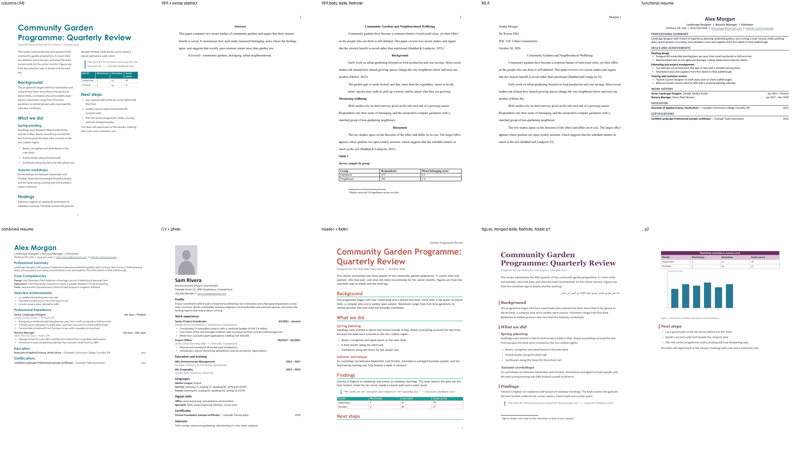
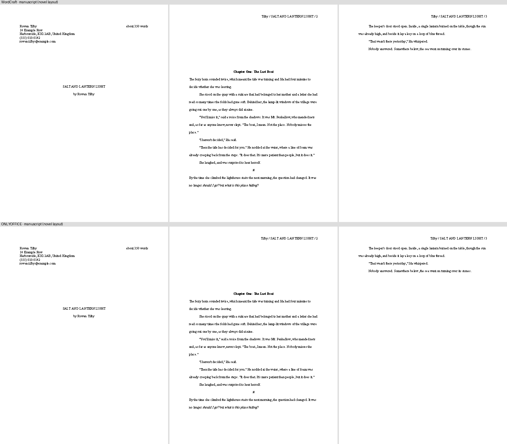

# Document styles

Eight ready-made looks. Each comes as a **document** (title, headings, body, bullets, quote, table, optional figure, footnote and right-to-left or CJK text), an **ATS-friendly résumé**, a
**European-style CV**, and (for the academic style) an **APA or MLA student paper**, on **US Letter or A4**. One plan feeds both
WordCraft and ONLYOFFICE, so they produce the same look. All sample text is invented.

| Style | Look | Good for |
|---|---|---|
| `traditional` | Times, black, centred headings, justified text | Formal letters, legal-style documents, conservative readers |
| `elegant` | Constantia/Georgia, burgundy, letter-spaced small headings with a hairline rule, wide margins | Invitations, personal statements, boutique-client proposals |
| `clean` | Calibri, dark grey, lots of white space, no ornament | Everyday documents, memos, handouts |
| `professional` | Calibri, navy all-caps headings with a bottom rule | Business reports, proposals, ATS résumés |
| `academic` | Times 12 pt, double-spaced, first-line indents, plain bold headings | Essays and papers (with `paper`: APA or MLA layout) |
| `modern` | Century Gothic headings in teal, Corbel body, large title | Product docs, newsletters, design-aware résumés |
| `stylish` | Georgia italic plum headings with a gold bar, Candara body | Programmes, editorial handouts, brand-conscious proposals |
| `creative` | Coral headings, teal rule, Trebuchet, big title | Portfolios, workshop handouts, creative-field résumés |




More in `gallery/` (both apps; documents, résumés, A4 CVs, features).

## Use

```sh
python3 -I resolve.py                                   # which font each style gets on this machine
# WordCraft: writes the .docx
python3 -I build_wordcraft.py modern doc /abs/report.docx > job.json && wordcraft-cli run --script job.json
# ONLYOFFICE (headless): add --pdf to also save a PDF rendered by ONLYOFFICE, for checking
python3 -I build_onlyoffice.py modern doc /abs/report.docx > calls.json && python3 -I ../onlyoffice/tools/ooc.py new:docx calls.json
```

`KIND` is `doc`, `resume`, `cv`, `paper` or `manuscript` (see below; the STYLE argument is ignored for it). Options, the same in both builders (`--name=value`):

| Option | Applies to | What it does |
|---|---|---|
| `--paper=letter` / `--paper=a4` | all | Page size. Default Letter; `cv` defaults to A4. |
| `--page-numbers=bottom-center` / `bottom-right` / `top-right` | all | Page number in the footer or header. |
| `--header-text="Short title"` | all | Text in the header (with `top-right`, text then number). |
| `--columns=2` | `doc` | Body in two columns after the title (newsletter feel). |
| `--photo=/abs/pic.png` | `resume`, `cv` | Portrait above the name. |
| `--layout=chronological` / `functional` / `combined` | `resume` | Which résumé structure. |
| `--format=apa` / `--format=mla` | `paper` | Student-paper layout. |
| `--extras` | `paper` | Abstract (APA), block quote, captioned table. |
| `--figure=sample` / `--figure=/abs/pic.png` | `doc` | Picture with a caption after the table. |
| `--merged-table` | `doc` | Adds a merged title row above the table header. |
| `--footnotes` | `doc`, `paper` | One sample footnote. |
| `--script=arabic` / `hebrew` / `japanese` / `chinese` / `korean` | `doc` | One sample sentence in that script (right-to-left handled). |
| `--local-fonts` | all | Allow fonts installed here but not shipped with Office. |
| `--overwrite` | all | Replace an existing output file (otherwise the builder refuses). |

Cautions (for example "photo is not ATS-safe") are printed to stderr. Replace the invented text in `content.py` with real content; keep the
block types. To restyle a real document instead of the sample, copy the style-setting part of a builder onto the document's existing styles
and give paragraphs the style names (`Heading 1`, `Heading 2`, `Doc Title`, …). Always work on a copy of someone's document.

## Manuscript for a publisher or agent (`manuscript`)



Standard manuscript format as most fiction submissions expect it: 12 pt Times New Roman (or Courier New), double-spaced, 1-inch margins, ragged right,
0.5-inch first-line indents, no extra space between paragraphs, italics (not underlining) for emphasis, a title page, a running header
`Surname / TITLE / page` that does not print on page 1, chapters on new pages starting about a third of the way down, `#` for scene breaks, `THE END`.
**Always follow the publisher's or agent's own guidelines first**: this is the common default, not a rule everyone shares.

```sh
python3 -I build_wordcraft.py x manuscript /abs/book.docx --title="My Title" --author="Jane Doe" --address="1 Main St|Anytown, ST 00000" \
    --phone="555-0100" --email=jane@example.com --text=/abs/my-text.txt > job.json && wordcraft-cli run --script job.json
python3 -I manuscript_check.py /abs/book.docx            # PASS / WARN / FAIL against the rules above
```

| Option | What it does |
|---|---|
| `--text=/abs/file.txt` | Your text. A line `# Chapter One` starts a chapter; a line `#` or `* * *` alone is a scene break; blank lines separate paragraphs; `*word*` is italic; `THE END` closes the book. Without it, an invented sample is built. |
| `--title=` `--author=` `--pen=` `--surname=` | Title page and header. `--pen` is the byline if it differs from the legal name; the surname defaults to the last word of the author. |
| `--address="Line 1\|Line 2"` `--phone=` `--email=` | Contact block, top left of the title page. |
| `--wordcount=N` | The "about N words" line. Default: counted from your text and rounded (nearest 50 under 1,000, 100 under 10,000, otherwise 1,000). |
| `--font=courier` | Courier New instead of Times New Roman (same layout). |
| `--layout=short` | Short story: the text starts on the title page below the byline (default `novel`: separate title page, every chapter on a new page). |
| `--paper=a4` | A4 instead of US Letter. |

What to know (all verified on WordCraft 0.11.0 and ONLYOFFICE 10.0.0; both apps render the same pages):
- The word count is **not a field**: it is the number the builder counted. Re-run the builder (or change `--wordcount`) after editing the text.
- Chapter openings use six empty double-spaced paragraphs to drop a third of the way down, because WordCraft's layout ignores "space before" at the top of a page. They are
  intentional (`manuscript_check.py` allows runs of up to seven).
- Chapter headings are real `Heading 1` paragraphs, so a Word-style navigation pane or an accessibility checker sees the structure.
- Not covered: footnotes, tables, pictures, poetry, an end-of-document page count, a table of contents, a synopsis or query letter.

## ATS-friendly, or good for humans?

An applicant-tracking system reads the *structure* of a file, not its look. Everything a builder produces for `resume` and `cv` is a single column of
real text with real heading styles, plain bullets, text hyperlinks and dates on a tab stop, so structurally all eight styles are ATS-safe. That is
based on common ATS guidance; **it was not tested against any real ATS software**. The things that do break parsing are features, not styles:

| Feature | For people | For ATS |
|---|---|---|
| Single column, real headings, plain bullets (all résumé and CV styles) | good | **safe** |
| Chronological or combined layout | good | **safe** |
| Functional layout (skills first, short work history) | good if you must hide gaps; some recruiters distrust it | parses, but skills are cut off from dates and employers: use sparingly |
| `traditional`, `clean`, `professional`, `academic` | conservative, familiar | safest choice for online portals |
| `elegant`, `modern`, `stylish`, `creative` | more memorable | structure is still safe; colour and decoration are ignored, so use them for résumés a person will read |
| Photo | expected in some countries, unwanted in the US and UK | ignored at best; avoid for portals |
| Columns, tables, text boxes, graphics, icon bars (`--columns`, tables in `doc`) | fine in reports and newsletters | **not safe in résumés**: text can be read in the wrong order or dropped |
| Contact details in the header/footer | tidy | **often skipped** by parsers: keep them in the body |

So: send a `professional`/`clean`/`traditional` résumé (or any style, as long as it is the plain single-column build) through online portals, and
use a designed style, a photo or columns for a copy you hand to a person.

## Check a résumé: `ats_check.py`

```sh
python3 -I ats_check.py resume.docx [more.docx]      # PASS / WARN / FAIL lines; exit code 1 if any FAIL
```

A read-only lint of the structures that commonly break applicant-tracking parsers: **FAIL** for tables, text boxes, more than one column, contact
details only in a header or footer, or no e-mail address in the body; **WARN** for pictures, bullets typed as characters, headings an ATS may not
recognise, fewer than two dates, or text in headers/footers. It resolves style *names* (ONLYOFFICE writes numeric style ids such as `139` for "Heading 1";
parsers read the name). It is a checklist, not a parser: a file that passes can still fail in a particular ATS, and nothing here was tested against one.
Checked: it passes the generated résumés and CVs in both apps, flags the photo CV and a columns/tables document, fails a deliberately bad file
(layout table, header-only contact, glyph bullets), and passes a hand-made résumé built for ATS.

## Tables, headers and footers, columns

- **Tables** in `doc`: a thin grid, a filled header row in the style's colour, small body text; the header row repeats on a new page in WordCraft. `--merged-table` adds a title row merged across all columns (shown in both apps).
  (Per-side borders and banded rows are not supported by WordCraft's border command, so both apps use the same simple grid.)
- **Headers and footers**: `--page-numbers` and `--header-text`. `paper` builds the page-number header APA and MLA expect (MLA: surname and number).
- **Columns**: two newspaper-style columns for the body, the title spanning the page.

## Figures, footnotes, other scripts

- **Figure**: picture in its own paragraph with a caption underneath ("Figure 1. …"); the sample is `assets/sample-figure.png` (invented data). Alt text is set in both apps (WordCraft through `insert.picture`'s `alt`; ONLYOFFICE through `SetDescription` on the drawing, because its image tool has no alt-text parameter).
- **Footnotes** come from each app's own footnote feature, so they renumber and move with the text. WordCraft places the mark right after the phrase; ONLYOFFICE's footnote tool always puts it at the **end of the paragraph** containing the phrase.
- **Right-to-left (Arabic, Hebrew)**: WordCraft gets a true right-to-left paragraph (`bidi`); in such a paragraph "left" alignment means the *start* edge, so it ends up on the right of the page.
  This ONLYOFFICE build has no macro call for paragraph direction, so those paragraphs are right-aligned with the right font and proofing language: the letters, shaping and punctuation render correctly,
  but the paragraph is still left-to-right underneath. For fully right-to-left documents use WordCraft, or switch the direction in the ONLYOFFICE editor.
- **CJK (Japanese, Chinese, Korean)**: set the East-Asian font (`fontEa` in WordCraft, the run font in ONLYOFFICE) and the proofing language. The samples use Noto Sans CJK here; on other machines Office substitutes its own CJK fonts.
  The sample sentences are short and simple; have a native reader check wording before you reuse them.

## Papers (APA 7 and MLA 9 layout)

`paper` uses the `academic` look: Times 12 pt, 1 in margins, double spacing, 0.5 in first-line indent, page number top right, hanging-indent
reference list. `--format=apa`: title page (bold title, author, affiliation, course, instructor, date), then the paper from page 2 with centred
bold level-1 and left bold level-2 headings, then *References*. `--format=mla`: no title page; four-line heading block at the top left, centred
title, *Works Cited* on a new page, "Surname page" header. This is a layout aid, not a style-guide checker: the sample sources are fictional and
details such as running heads for professional papers, multi-level heading rules and figure captions are not shown. `--extras` adds an abstract (APA), a block quote and a captioned table; APA tables normally use horizontal rules only, but neither app's border tools can set borders per side, so the sample table has a plain grid. Check your instructor's or journal's current guide.

## Paper size

`--paper=letter` or `--paper=a4`. The builders set the page size, margins and the right-hand tab used for dates. A4 is narrower and taller
(595 × 842 pt) than Letter (612 × 792 pt). Checked: both sizes report the right page size in both apps.

## CV (European style)

`cv` is a single-column curriculum vitae in the order European employers expect: name, role and contact lines; *Profile*; *Work experience* (newest
first, dates as `MM/YYYY – present`); *Education and training* (degree and years, institution below); *Languages* (mother tongue, then each language
with CEFR levels A1–C2 for listening, reading, speaking and writing); *Digital skills*; *Certificates*; *Interests*. It is inspired by the Europass
structure but is **not** the official Europass template. A photo, date of birth, nationality and marital status are expected in some countries and
discouraged or unlawful to ask for in others (including the US and UK), so none are included; add them only where the local norm calls for it.
Two pages are normal for a senior CV.

## Europass

The official Europass CV is an EU template and online editor, so it is deliberately **not** reproduced here. The `cv` kind follows the same section order so the
content transfers: Profile (personal statement) → Work experience → Education and training → Languages (mother tongue, then CEFR levels) → Digital skills → Certificates →
Interests. To get an official Europass file, enter the same content in the editor on the Europass website (its fields change over time, so check the current form); use this
`cv` kind for a plain, ATS-friendly .docx or PDF of the same information.

## Fonts and fallbacks

Each style lists fonts in order of preference in `styles.json`; `resolve.py` picks the first one that is **installed**. By default it also requires a
font that ships with Microsoft Office (Calibri, Cambria, Candara, Century Gothic, Constantia, Corbel, Georgia, Arial, Times New Roman, Trebuchet MS,
Verdana…), so a file opens the same on a colleague's computer. `--local-fonts` lets any installed font win (e.g. Montserrat): only use it for
documents that stay on this machine or embed the fonts. If a preferred font is missing, the resolver reports it and uses the next one.

## Checked

Every style as `doc`, `resume` and `cv`, and the feature samples (columns, APA, MLA, functional, combined, photo, header and footer), were built in
both apps and rendered (WordCraft with its own renderer, ONLYOFFICE through its own PDF export). The builders check for macro errors and refuse to
overwrite an existing file unless asked.

Not covered: the official Europass template (see above); app-managed citations and bibliographies (WordCraft has a citation feature that this sample does not use; ONLYOFFICE's reference tooling was not checked; here references are typed text); vertical CJK text; mixed-direction paragraphs; real-ATS testing.
